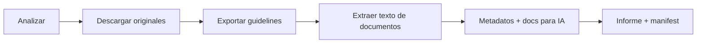

<div align="center">


<br>

**Exporta todo lo accesible de un Frontify a una carpeta local impecable, lista para alimentar a tu IA.**


[⚡ Inicio rápido](#-inicio-rápido) · [🗂 La carpeta resultante](#-la-carpeta-resultante) · [🛡 Fiabilidad](#-fiabilidad) · [🧠 Para IA](#-pensado-para-ia) · [⚠️ Límites reales](#️-límites-reales-de-la-api)

</div>

---

## ✨ ¿Qué hace?

Introduces la **URL**, el **token** y pulsas **EXPORTAR TODO**. La herramienta:

| | |
|---|---|
| 🔎 **Analiza** | marcas, workspaces, librerías, colecciones, carpetas y subcarpetas, guidelines y sus páginas |
| 📥 **Descarga** | los **archivos originales** (nunca previews): logos, imágenes, vídeos, PDFs, fuentes, documentos… |
| 📝 **Exporta** | guidelines a **Markdown** (con su jerarquía), textos, descripciones, etiquetas y **todos los metadatos** |
| 🔗 **Conserva** | la ubicación original de cada archivo en Frontify y las relaciones entre recursos |
| 🧠 **Genera** | documentos de contexto para IA, escritos **solo con datos reales** (sin inventar nada) |
| 📊 **Informa** | de lo exportado, lo omitido y lo que falló, con el motivo de cada caso |

> Una app local y sencilla: **sin SaaS, sin cuentas, sin base de datos, sin servicios externos**. Solo sistema de archivos, JSON y Markdown.

---

## ⚡ Inicio rápido

Elige tu estilo. Todos producen la misma carpeta.

### 🐳 Opción 1 · Un comando, sin interfaz *(Docker)*

Construye, exporta, deja todo en `./EXPORTS` y **cierra el contenedor** al terminar.

```bash
# macOS / Linux (o Git Bash / WSL en Windows)
./export.sh --url https://cliente.frontify.com --token TU_TOKEN --name CLIENTE_01
```

```powershell
# Windows (PowerShell)
.\export.ps1 -Url https://cliente.frontify.com -Token TU_TOKEN -Name CLIENTE_01
```

<details>
<summary>Más detalles de los scripts</summary>

- Token y URL por **parámetro**, por **variables de entorno** (`FRONTIFY_TOKEN`, `FRONTIFY_URL`) o en un **`.env`** junto al script.
- `--concurrency N` / `-Concurrency N`: descargas en paralelo (4 por defecto).
- El token viaja al contenedor por entorno, no por la línea de comandos.
- Código de salida `0` = sin errores · distinto de `0` = hubo fallos (ver `EXPORT_REPORT.json`).
- Si Windows bloquea el script: `powershell -ExecutionPolicy Bypass -File .\export.ps1 -Url … -Token …`

</details>

### 🖥 Opción 2 · Con interfaz web *(Docker)*

```bash
docker compose up --build
```

Abre **http://localhost:8765** → URL + token → **ANALIZAR FRONTIFY** → **EXPORTAR TODO**.
Resultados en `./EXPORTS`. El puerto solo escucha en `localhost`.

### 🐍 Opción 3 · Sin Docker

```bash
python -m venv .venv && . .venv/bin/activate      # Windows: .venv\Scripts\activate
pip install -r requirements.txt
python -m src                                      # abre la interfaz en http://127.0.0.1:8765
# o sin interfaz:
FRONTIFY_TOKEN=… python -m src export --url https://cliente.frontify.com --dest EXPORTS --name CLIENTE_01
```

---

## 🗂 La carpeta resultante

Cada cliente tiene su propia carpeta, organizada automáticamente según lo que se encuentre (solo se crean las categorías con contenido).

```
EXPORTS/CLIENTE_01/
├── 📘 README_AI.md              ← por dónde empezar (humanos e IA)
├── 📊 EXPORT_REPORT.json        ← totales, errores y motivos, recursos inaccesibles
├── 🔐 manifest.json             ← cada fichero con tamaño y SHA-256
├── 01_BRAND_GUIDELINES/<marca>/ ← una página .md por página de guideline + _original/ + _media/
├── 02_ASSETS/
│   ├── LOGOS/ IMAGES/ PHOTOGRAPHY/ VIDEOS/ ICONS/ ILLUSTRATIONS/ AUDIO/ OTHER/
│   └── …/<marca>/<librería>/<carpetas originales…>/<archivo original>
├── 03_DOCUMENTATION/            ← PDFs, DOCX… + _extracted_text/
├── 04_DESIGN_SYSTEM/            ← fuentes descargables + Brand Essentials (JSON)
├── 05_METADATA/<marca>/         ← assets · folders · projects · relationships · essentials (JSON)
└── 06_AI_KNOWLEDGE/             ← los documentos para IA 👇
```

> 🔗 **Nunca se pierde la relación con Frontify**: la ruta original (librería / carpeta / ID) de cada archivo está en `05_METADATA/<marca>/assets.json` y en `ASSET_INDEX.md`.

---

## 🧠 Pensado para IA

En `06_AI_KNOWLEDGE/` encontrarás, generados a partir de datos reales de la API:

| Documento | Contenido |
|---|---|
| `BRAND_OVERVIEW.md` | Resumen de la marca: librerías, colecciones, guidelines, totales |
| `VISUAL_IDENTITY.md` | Logotipos, **colores** (HEX/Pantone) y **tipografías** |
| `BRAND_GUIDELINES.md` | Todas las guidelines en Markdown, en el orden de Frontify |
| `ASSET_INDEX.md` | Índice de recursos con nombre, descripción, etiquetas y ruta al original |
| `DESIGN_SYSTEM.md` | Colores, tipografías y documentación de diseño disponible |
| `CONTENT_INDEX.md` | Índice de todo lo exportado, con estado de cada documento |

**Reglas de oro:** los originales jamás se sustituyen por resúmenes · si un dato no existe, el documento dice *“Not available”* en lugar de inventarlo · todo lleva su fuente (URL / ID de Frontify).

---

## 🛡 Fiabilidad



- ♻️ **Reanudable**: relanza y continúa; las descargas parciales se retoman (HTTP Range).
- 🧬 **Incremental**: no vuelve a bajar lo que no cambió; si un archivo cambió, la versión anterior se conserva en `_previous_versions/`.
- ✅ **Integridad**: tamaño + SHA-256 por archivo; **duplicados** detectados (se conservan y se anotan).
- 🚦 **Resiliente**: paginación completa, reintentos con backoff (429/5xx/red) y concurrencia configurable. **Un fallo nunca detiene el resto.**
- 🔒 **Seguro**: el token solo vive en memoria o en tu entorno, se oculta de los logs y nunca va al CDN. La interfaz solo escucha en `127.0.0.1`. Se respetan los permisos de Frontify.

---

## ⚠️ Límites reales de la API

Honestidad por delante; también se listan en cada `EXPORT_REPORT.json`:

- 🎨 **Design tokens y componentes**: la API GraphQL oficial no los ofrece. `DESIGN_SYSTEM.md` usa Brand Essentials (colores, tipografías) y las páginas de guidelines.
- 📄 **PDF de guidelines**: no existe en la API → se exporta Markdown + JSON original (los PDFs que sean *assets* sí se descargan).
- 🖼 Los assets incrustados en bloques de guidelines solo exponen una previsualización (sin ID).
- 🏷 Logos / fotografía / iconos / ilustraciones se clasifican por nombre y carpeta (no hay un campo en la API).
- 🚫 No se exportan variantes, revisiones, comentarios, licencias ni workflows.

> 🧪 **Estado de verificación:** las consultas siguen la [referencia oficial](https://frontify.github.io/graphql-reference/) y los 21 tests corren contra un Frontify **simulado**. **Aún no se ha probado contra una instancia real**: tu primera ejecución es la prueba definitiva. Si algo falla, queda en el informe en vez de ocultarse. Detalle en [`docs/FRONTIFY_API.md`](docs/FRONTIFY_API.md).

---

## 🧰 Desarrollo

```bash
pip install -r requirements-dev.txt
pytest && ruff check src tests && mypy src
python -m tests.serve_fake      # la UI real contra un Frontify simulado (token: test-token-123456)
```

<div align="center">
<sub>Hecho para que cualquier IA entienda tu marca sin perder contexto. ✦</sub>
</div>
